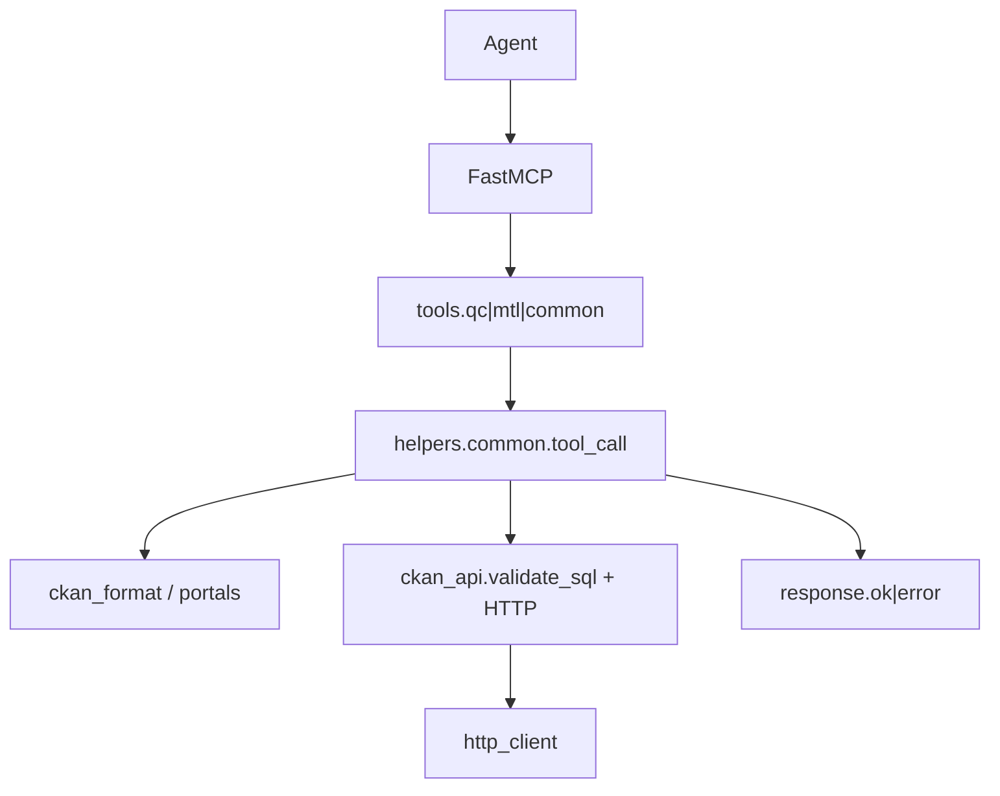

# Architecture overview

Données Québec MCP is a Streamable HTTP server that exposes Québec open data to AI agents. It covers CKAN catalogues (provincial and Montréal), DataStore SQL, IGO geospatial services, geocoding, OQLF Vitrine linguistique, NosOrigines, and Montréal apps (murales, La bicyclette, Collecte MTL).

This is a community project, not an official Gouvernement du Québec service. Tools are read-only against public APIs. Successful responses add a `_meta` block with provenance (`source`, `portal_url`, optional licence and ids).

## Package layout

```
tools/
  common/          # common_get_version, common_list_tools_with_examples
  qc/              # Données Québec CKAN + data access + intelligence
    geo/           # IGO, geocode, coords
    oqlf/          # Vitrine linguistique
    nosorigines/
  mtl/             # Montréal CKAN
    murales/
    labicyclette/
    collecte/
helpers/
  common/          # config, http_client, response, ckan_api, portals, ckan_format, tool_call
  qc/geo|oqlf|nosorigines/
  mtl/             # citations, murales_api, labicyclette_*, collectemtl_api
tests/             # mirrors domains; fixtures under tests/fixtures/ckan/
```

MCP tool names are domain-prefixed (`qc_*`, `qc_geo_*`, `mtl_murales_*`, `common_*`, …).

## Request path



`run_tool` keeps `ValueError` messages (for example SQL validation) and turns other failures into a logged generic error. Portal configs (`DQ_PORTAL`, `MTL_PORTAL`) keep API base URLs and dataset link templates in one place.

## Components

- `main.py` / `asgi.py`: logging, Sentry, Streamable HTTP (local) or ASGI export (Vercel).
- `tools/__init__.py`: shared FastMCP instance, `/health`, `register_all_tools()` via importlib.
- `helpers/common/ckan_api.py`: CKAN actions and read-only SQL checks (sqlglot).
- `helpers/common/http_client.py`: timeout, retry, rate limit, in-memory GET cache, download caps.
- `helpers/common/response.py`: `_meta` citation envelope on success.
- Domain helpers under `helpers/qc/` and `helpers/mtl/` own source-specific parsing.

## Diagrams

| Diagram | Source | Rendered |
| --- | --- | --- |
| Domain packages (class) | [domain_packages.puml](diagrams/domain_packages.puml) | [domain_packages.svg](diagrams/domain_packages.svg) |
| Components | [components.puml](diagrams/components.puml) | [components.svg](diagrams/components.svg) |
| SQL query sequence | [query_sql_sequence.puml](diagrams/query_sql_sequence.puml) | [query_sql_sequence.svg](diagrams/query_sql_sequence.svg) |
| Tool registration sequence | [register_tools_sequence.puml](diagrams/register_tools_sequence.puml) | [register_tools_sequence.svg](diagrams/register_tools_sequence.svg) |
| Citation flow | [citation_flow.mmd](diagrams/citation_flow.mmd) | [citation_flow.svg](diagrams/citation_flow.svg) |

Regenerate SVGs with PlantUML/Kroki (or the repo’s uml-mcp tooling) when the `.puml` sources change.

## Tests

Default `make test` / `uv run pytest` stays offline (`-m "not network"`). Live CKAN checks live under `@pytest.mark.network` (`make test-network`). Integration fixtures for package search and DataStore SQL are in `tests/fixtures/ckan/`.
